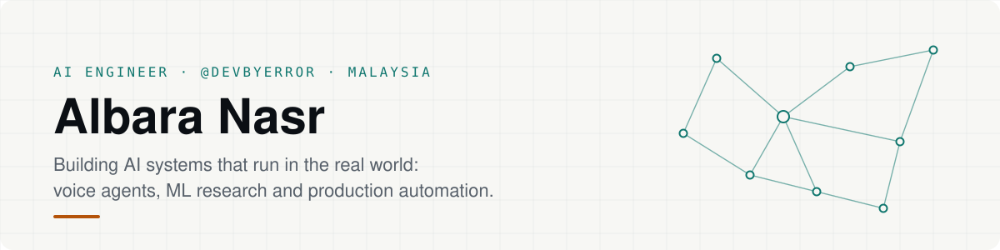
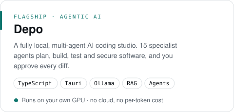
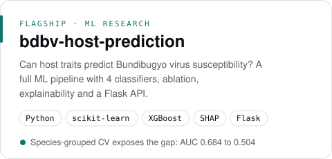
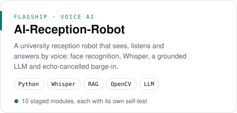
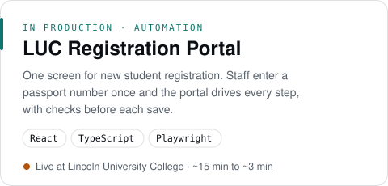
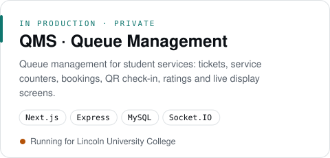
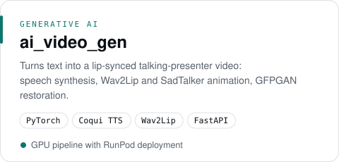
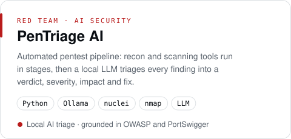

<picture>
  <source media="(prefers-color-scheme: dark)" srcset="assets/banner-dark.svg">
  
</picture>

  
  
  

  <a href="#featured-work">Featured work</a> ·
  <a href="#ai-security">AI security</a> ·
  <a href="#running-in-production">In production</a> ·
  <a href="#more-projects">More projects</a> ·
  <a href="#activity">Activity</a> ·
  <a href="#toolbox">Toolbox</a>

I build AI systems that leave the notebook and do real work. That means voice agents that hold a conversation at a front desk, machine-learning studies that are honest about what a model has actually learned, and automation that staff at a university use every day.

- **Applied AI:** speech-to-text, LLM pipelines with retrieval, text-to-speech, computer vision, AI for security testing
- **Machine learning and research:** feature engineering, model evaluation, explainability
- **Production software:** full-stack web apps and workflow automation running for real organizations

## Featured work

<table>
  <tr>
    <td width="50%" valign="top">
      <a href="https://github.com/DevByError/Depo">
        <picture>
          <source media="(prefers-color-scheme: dark)" srcset="assets/card-depo-dark.svg">
          
        </picture>
      </a>
    </td>
    <td width="50%" valign="top">
      <a href="https://github.com/DevByError/bdbv-host-prediction">
        <picture>
          <source media="(prefers-color-scheme: dark)" srcset="assets/card-bdbv-dark.svg">
          
        </picture>
      </a>
    </td>
  </tr>
  <tr>
    <td width="50%" valign="top">
      <a href="https://github.com/DevByError/AI-Reception-Robot">
        <picture>
          <source media="(prefers-color-scheme: dark)" srcset="assets/card-robot-dark.svg">
          
        </picture>
      </a>
    </td>
    <td width="50%" valign="top">
      <a href="https://github.com/DevByError/luc-reg-automation">
        <picture>
          <source media="(prefers-color-scheme: dark)" srcset="assets/card-lucreg-dark.svg">
          
        </picture>
      </a>
    </td>
  </tr>
  <tr>
    <td width="50%" valign="top">
      <a href="https://luc.techvisionsoft.com/login">
        <picture>
          <source media="(prefers-color-scheme: dark)" srcset="assets/card-qms-dark.svg">
          
        </picture>
      </a>
    </td>
    <td width="50%" valign="top">
      <a href="https://github.com/DevByError/ai_video_gen">
        <picture>
          <source media="(prefers-color-scheme: dark)" srcset="assets/card-videogen-dark.svg">
          
        </picture>
      </a>
    </td>
  </tr>
</table>

### What's inside the flagships

**[Depo](https://github.com/DevByError/Depo)** · agentic AI 
A fully local, multi-agent AI coding studio for Windows. You describe the software you want, and a team of 15 specialist agents (manager, backend, frontend, database, tester, security, UX) plans, builds, tests, secures and documents it. They review each other's work and fix problems until the tests pass. Every change happens in a shadow copy, and you approve it in a diff review before it reaches your files. It runs entirely on local models through Ollama, llama.cpp or LM Studio, picks models to fit your GPU's VRAM, and uses code retrieval so it stays fast on modest hardware. Built with Tauri 2, React and a Bun engine.

**[bdbv-host-prediction](https://github.com/DevByError/bdbv-host-prediction)** · machine-learning research 
A study of whether host biology, ecology and taxonomy can predict which species Bundibugyo virus can infect. It covers the full pipeline: 51 engineered features, four classifiers, bootstrap confidence intervals, ablation, permutation importance and a Flask prediction service. The key finding is that a random split reports ROC-AUC 0.684, while species-grouped cross-validation drops to 0.504. The write-up shows why, and why evaluation design matters more than model choice.

**[AI-Reception-Robot](https://github.com/DevByError/AI-Reception-Robot)** · voice AI 
A reception robot for a university front desk. It notices people who stop in front of it, greets them, listens and answers by voice. Under the hood: YuNet and SFace face recognition with consent-based memory, faster-whisper speech-to-text with end-of-turn detection, WebRTC echo cancellation so visitors can interrupt, answers grounded in the university website through retrieval, and an LLM fallback chain (Groq or Gemini, then local Ollama). It is built as ten stages, each with its own self-test, and the measured results are documented.

**[ai_video_gen](https://github.com/DevByError/ai_video_gen)** · generative AI 
A pipeline that turns text into a lip-synced presenter video. It combines Coqui text-to-speech, Wav2Lip and SadTalker for face animation, GFPGAN for face restoration and generated slides, behind a FastAPI service with a RunPod GPU deployment script.

## AI security

Two sides of the same field: using AI to secure systems, and securing the AI itself. On one side, AI automates the security tools, the bug detection and the triage. On the other, the work protects LLMs, RAG pipelines and AI agents from attacks such as prompt injection, data leakage and unsafe tool use.

Cards are color-coded: red for offensive (red team), blue for defensive (blue team), purple for securing AI systems.

<table>
  <tr>
    <td width="50%" valign="top">
      <a href="https://github.com/DevByError/pentriage-ai">
        <picture>
          <source media="(prefers-color-scheme: dark)" srcset="assets/card-pentriage-dark.svg">
          
        </picture>
      </a>
    </td>
    <td width="50%" valign="top">
    </td>
  </tr>
</table>

**[PenTriage AI](https://github.com/DevByError/pentriage-ai)** · red team 
You give it a target that is in scope. It runs subfinder, httpx, and then nuclei, katana, nmap and testssl in parallel, merges and de-duplicates the results, and has a local Qwen 2.5 model review each finding type like a senior security engineer: real or false positive, confidence, severity, impact, fix and safe verification steps. It is grounded in a local OWASP and PortSwigger knowledge base, so a normal run costs no API tokens, with an optional Claude second opinion for uncertain findings. Output is an HTML report and a local dashboard, and new tools plug in as plugins.

## Running in production

These systems are live and used by real organizations. Where the source is private, the link goes to the running system.

| System | What it does | Stack | Status |
|---|---|---|---|
| **[LUC Registration Portal](https://github.com/DevByError/luc-reg-automation)** | One-screen student registration for staff at Lincoln University College. Registration time went from about 15 minutes to about 3. | React, TypeScript, Playwright |  Public repo |
| **[QMS, Queue Management System](https://luc.techvisionsoft.com/login)** | Queue management for student services: tickets, service counters, bookings, QR check-in, ratings and live display screens. | Next.js, Express, MySQL, Socket.IO |   |
| **[SAICM Student Portal](https://saicmss.site)** | Student web portal for events, sports, society news and profiles, alongside the SAICM phone app. | Web app |   |
| **[Yalla Habibi](https://new.yallahabibi.com.my/)** | Website for a Middle Eastern restaurant in Malaysia. | Web |   |

## More projects

| Project | Description |
|---|---|
| **SignCraft** · [web app](https://github.com/DevByError/signcraft-frontend) · [backend](https://github.com/DevByError/signcraft-backend) · [Android player](https://github.com/DevByError/android-screen) | A digital signage system. Design screen content in a canvas editor, group it into playlists, render to video and push it to Android screens in real time. |
| **[Ecoprise](https://github.com/DevByError/ecoprise-full)** | A platform for tracking and reducing a business's electricity, waste and transport footprint, with an AI assistant on each dashboard and a regression model for electricity forecasts. |
| **ROES** · [mayor dashboard](https://github.com/DevByError/roes) · [mobile app](https://github.com/DevByError/roes_app) | A city-management platform for mayors, place admins and residents, with a web dashboard and an Expo mobile app. |

## Activity

<picture>
  <source media="(prefers-color-scheme: dark)" srcset="https://raw.githubusercontent.com/DevByError/DevByError/output/snake-dark.svg">
  
</picture>

  <picture>
    <source media="(prefers-color-scheme: dark)" srcset="https://streak-stats.demolab.com?user=DevByError&theme=dark&background=0B0F14&border=1F2A36&ring=5EEAD4&fire=F5B83D&currStreakLabel=5EEAD4&hide_border=false">
    
  </picture>

## Toolbox

  

**AI and ML:** faster-whisper, LLM APIs (Groq, Gemini), Ollama, retrieval with sentence embeddings, ONNX Runtime, Kokoro and Piper TTS, YuNet and SFace, scikit-learn, XGBoost, SHAP 
**Software:** Python, TypeScript, React, Next.js, Node.js, Express, Flutter, MySQL, Socket.IO, Playwright, Docker

## Let's talk

Open to AI engineering roles, research collaborations and production projects. The fastest way to reach me is [LinkedIn](https://www.linkedin.com/in/albara-ahmed-629997267/) or [email](mailto:baranasrmohamed@gmail.com).
